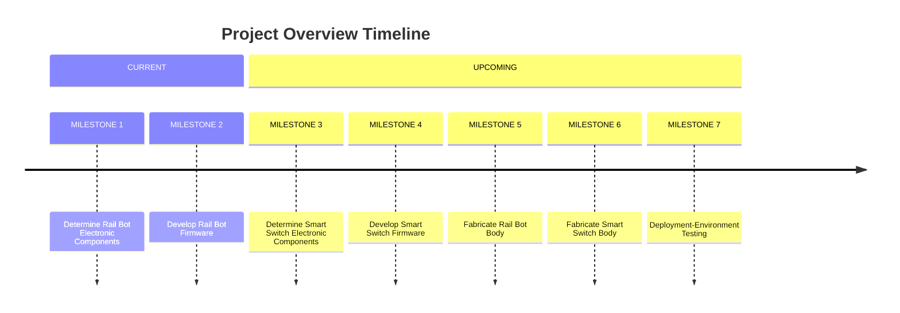

<a id="readme-top"></a>


<div align="center">

[![Contributors][contributors-shield]][contributors-url] &emsp; [![License][license-shield]][license-url]

</div>


<!-- PROJECT LOGO -->
<br/>
<div align="center">
  <a href="https://github.com/Dmitri-Viggo-Barks/ShadeGlide">
    
  </a>

  <h3 align="center">ShadeGlide</h3>

  <p align="center">
    An embedded systems project that includes firmware, electronics, and fabrication.
    <br />
    <a href="https://github.com/Dmitri-Viggo-Barks/ShadeGlide"><strong>Explore the repository »</strong></a>
    <br />
    <a href="https://github.com/Dmitri-Viggo-Barks/ShadeGlide/tree/main/docs/demo.mp4">View Project Demo</a>
  </p>
</div>

---

<!-- TABLE OF CONTENTS -->
<details>
  <summary>Table of Contents</summary>
  <ol>
    <li><a href="#about-the-project">About The Project</a></li>
    <li><a href="#usage---how-to-use-the-product">Usage - How To Use The Product</a></li>
    <li><a href="#project-milestones">Project Milestones</a></li>
    <li><a href="#getting-started-in-development">Getting Started In Development</a></li>
    <li><a href="#contributing-to-the-project">Contributing To The Project</a></li>
    <li><a href="#projects-license">Project's License</a></li>
    <li><a href="#projects-handler-contact">Project's Handler Contact</a></li>
    <li><a href="#acknowledgments">Acknowledgments</a></li>
  </ol>
</details>

---

## About The Project
<!-- <div align="center">

  <a href="img directory URL goes here">
    
  </a>

</div> -->

<strong>ShadeGlide</strong> is an open-source personal <strong>embedded systems</strong> project that creates a small, lightweight bot that moves from side to side along a curtain railing to <strong>open or close a curtain</strong>, <strong>wirelessly controlled</strong> by a smart switch.
<br/>
<br/>
The project creates two products, a Rail Bot and a Smart Switch. Both are controlled by an <strong>ESP32-C3 Super Mini</strong> MCU, with the Smart Switch's MCU commanding the Rail Bot's MCU using <strong>Bluetooth Low Energy</strong>. The Rail Bot moves using a <strong>GA-12 N20 DC Motor</strong> driven by a <strong>DRV8833 Motor Driver Breakout Module</strong>. When the Rail Bot moves, it stops when obstructions are on its way through its <strong>VL53L0X ToF Sensor module</strong>. Both products being powered by a rechargeable Lithium-ion battery.


<div align="center">

<h3 align="center">Topics in this Project</h3>

![3d--printing-topic][3d--printing-topic-Badge]
![bare--metal-programming-topic][bare--metal-programming-topic-Badge]
![bluetooth-low-energy-topic][bluetooth-low-energy-topic-Badge]
![curtain-bot-topic][curtain-bot-topic-Badge]
![electronics-topic][electronics-topic-Badge]
![embedded-systems-topic][embedded-systems-topic-Badge]
![esp--idf-framework-topic][esp--idf-framework-topic-Badge]
![esp32--c3-topic][esp32--c3-topic-Badge]
![esp32--c3-super-mini-topic][esp32--c3-super-mini-topic-Badge]
![firmware-development-topic][firmware-development-topic-Badge]
![hardware-topic][hardware-topic-Badge]
![microcontroller-programming-topic][microcontroller-programming-topic-Badge]
![wireless-communication-topic][wireless-communication-topic-Badge]

</div>


<div align="center">

### Built With and In

![ESP--IDF-VSCode-Extension][ESP--IDF-VSCode-Extension-Badge]![VSCode-Extension][VSCode-Extension-Badge] &ensp;
![KiCad][KiCad-Badge] &ensp;
![CMake][CMake-Badge] &ensp;
![C][C-Badge] &ensp;
![RISC--V][RISC--V-Badge]

</div>


<p align="right">(<a href="#readme-top">back to top</a>)</p>

<!-- USAGE EXAMPLES -->
## Usage - How To Use The Product
Use a <strong>18650 Protected 3.7V 2200mAh Lithium-ion Battery</strong> for both the Rail Bot and Smart Switch. <strong>Inspect the batteries for any damages, using a damaged or faulty battery can cause damage to the components of either product.</strong>  Ensure the batteries of both the Rail Bot and Smart Switch are charged before use.

1. Install the Rail Bot on the curtain rail, ensure the wheels clinch on the railing adequately.
2. Flip the Rail Bot's power switch on.
3. Flip the Smart Switch's power switch on.
4. ...

<div align="center">

  <a href="Instruction GIF directory URL">
    
  </a>

</div>

<p align="right">(<a href="#readme-top">back to top</a>)</p>


<!-- ROADMAP -->
## Project Milestones




<details>
<summary><strong><i>(CURRENT)</i> MILESTONE 1: Determine Rail Bot Electronic Components</strong></summary>

- [ ] Acquire Electronic Components
- [ ] Test and Validate Electronic Components
- [ ] Prototype Testing

</details>
<details>
<summary><strong><i>(CURRENT)</i> MILESTONE 2: Develop Rail Bot Firmware</strong></summary>

- [ ] Driver development and Testing
- [ ] BLE Communication
- [ ] Application Logic
- [ ] Startup and Initialization

</details>
<details>
<summary><strong>MILESTONE 3: Determine Smart Switch Electronic Components</strong></summary>

- [ ] Acquire Electronic Components
- [ ] Test and Validate Electronic Components
- [ ] Prototype Testing

</details>
<details>
<summary><strong>MILESTONE 4: Develop Smart Switch Firmware</strong></summary>

- [ ] BLE Communication
- [ ] Application Logic
- [ ] Startup and Initialization

</details>
<details>
<summary><strong>MILESTONE 5: Fabricate Rail Bot Body</strong></summary>
</details>
<details>
<summary><strong>MILESTONE 6: Fabricate Smart Switch Body</strong></summary>
</details>
<details>
<summary><strong>MILESTONE 7: Deployment-Environment Testing</strong></summary>

- [ ] Scenario Testing
- [ ] Troubleshooting

</details>


<p align="right">(<a href="#readme-top">back to top</a>)</p>


<!-- GETTING STARTED -->
## Getting Started In Development

### Clone The Repository
Create a directory for the local copy of the repository on your PC then open a Command Line Interface (Terminal / Powershell / etc.) pointing to that directory. Run the command below to clone the repository:

```bash
  git clone https://github.com/Dmitri-Viggo-Barks/ShadeGlide.git
```
### Development Scope
The project uses frameworks and environments for developing firmware, high-level hardware systems design, and 3D-printing fabrication. Before contributing to the project, read and refer to the project's contributing guidelines in `../.github/`: [`CONTRIBUTING.md`](../.github/CONTRIBUTING.md), it details the specific conventions and practices for developing the project. <br/>
<br/>
Depending on where the contribution scope is, the following are an enumeration of what is recommended to have to begin contributing:

#### Firmware
The project uses an ESP-IDF framework, so either the official Espressif ESP-IDF IDE or the ESP-IDF extension for Visual Studio Code can work.
- Install [ESP-IDF IDE](https://docs.espressif.com/projects/espressif-ide/en/latest/installation.html): https://docs.espressif.com/projects/espressif-ide/en/latest/installation.html
- Install [ESP-IDF Extension for Visual Studio Code](https://docs.espressif.com/projects/vscode-esp-idf-extension/en/latest/): https://docs.espressif.com/projects/vscode-esp-idf-extension/en/latest/

#### Electronics
The project uses KiCad version 10 for its high-level electronics system designing, though other programs are viable as long as they follow the project's conventions.
- Install [KiCad](https://www.kicad.org/download/): https://www.kicad.org/download/
- Rail Bot Electronic Components: to be determined
- Smart Switch Electronic Components: to be determined

#### Fabrication
The project's final products have a fabricated 3D-printed body. The programs used for this MILESTONE of the project are yet to be determined.

<p align="right">(<a href="#readme-top">back to top</a>)</p>


<!-- CONTRIBUTING -->
## Contributing To The Project
Before contributing to the project, read and refer to the project's contributing guidelines in `../.github/`: [`CONTRIBUTING.md`](../.github/CONTRIBUTING.md). <strong> If the contributor is outside the project's main team, fork the project and begin working there. </strong> Below is a brief process for contributing:

1. <strong>Create and Work on a New Branch</strong> <br/>
```bash
    # 1. Ensure the Feature Branch branches off of the base branch `main`.
    git checkout main                   # or `git switch main`

    # 2. Create and switch to the new branch, replace 'branch-name' with the created branch'es name.
    git checkout -b branch-name         # or `git switch -c branch-name

    # 3. Push the branch to the repository, replace 'branch-name' with the created branch'es name.
    git push -u origin branch-name
```


2. Commit your Changes (follow the project's Commit Conventions in [`CONTRIBUTING.md`](../.github/CONTRIBUTING.md))
4. Push to the Branch
5. Open a Pull Request (follow the project's Pull Request Conventions in [`CONTRIBUTING.md`](../.github/CONTRIBUTING.md))

### Contributors:
<a href="https://github.com/Dmitri-Viggo-Barks/ShadeGlide/graphs/contributors">
  
</a>

<p align="right">(<a href="#readme-top">back to top</a>)</p>


<!-- LICENSE -->
## Project's License
Distributed under the MIT License. See [`LICENSE`](../LICENSE) for more information.


<p align="right">(<a href="#readme-top">back to top</a>)</p>


## Project's Handler Contact
Contact the Project's handler for any inquiries or concerns:<br/>
[![Facebook][Facebook-Profile-Badge]][Facebook-Profile-URL] &emsp;[![Instagram][Instagram-Profile-Badge]][Instagram-Profile-URL] <br/>

Gmail<strong>: dmitriviggomajorenos.business@gmail.com</strong>


<p align="right">(<a href="#readme-top">back to top</a>)</p>


<!-- ACKNOWLEDGMENTS -->
## Acknowledgments
The following sources are acknowledged to be useful for the development of the project. Some are references as well as implemented to the project's development.

* [ESP32-C3 Super Mini KiCad Symbol](https://gitlab.warpzone.ms/infrastruktur/speaker-switcher/-/blob/a1d6ea9e9f12e4f386fc843185724b4619c5ae06/hardware/KiCad_ESP32-C3-SuperMini/ESP32-C3-SuperMini.kicad_sym) from [GitLab repository "Speaker Switcher"](https://gitlab.warpzone.ms/infrastruktur/speaker-switcher)
* [README.md template](https://github.com/othneildrew/Best-README-Template/blob/fc444eb7b04b2e4863f6080b1507a219e95103fa/BLANK_README.md) from [GitHub repository "Best-README-Template"](https://github.com/othneildrew/Best-README-Template)
* [ESP32-C3 Super Mini Technical Reference Manual](https://documentation.espressif.com/esp32-c3_technical_reference_manual_en.pdf) by [Espressif Systems](https://www.espressif.com/)


<p align="right">(<a href="#readme-top">back to top</a>)</p>

<br/>
<br/>

---

## END OF DOCUMENT


<!-- LINKS & IMAGES -->
[contributors-shield]: https://img.shields.io/github/contributors/Dmitri-Viggo-Barks/ShadeGlide.svg?style=for-the-badge
[contributors-url]: https://github.com/Dmitri-Viggo-Barks/ShadeGlide/graphs/contributors
[license-shield]: https://img.shields.io/github/license/Dmitri-Viggo-Barks/ShadeGlide.svg?style=for-the-badge
[license-url]: https://github.com/Dmitri-Viggo-Barks/ShadeGlide/blob/master/LICENSE.txt


[3d--printing-topic-Badge]: https://img.shields.io/badge/-3d--printing-green?style=flat
[bare--metal-programming-topic-Badge]: https://img.shields.io/badge/-bare%20metal%20programming-green?style=flat
[bluetooth-low-energy-topic-Badge]: https://img.shields.io/badge/-bluetooth%20low%20energy-green?style=flat
[curtain-bot-topic-Badge]: https://img.shields.io/badge/-curtain%20bot-green?style=flat
[electronics-topic-Badge]: https://img.shields.io/badge/-electronics-green?style=flat
[embedded-systems-topic-Badge]: https://img.shields.io/badge/-embedded%20systems-green?style=flat
[esp--idf-framework-topic-Badge]: https://img.shields.io/badge/-esp--idf%20framework-green?style=flat
[esp32--c3-topic-Badge]: https://img.shields.io/badge/-esp32--c3-green?style=flat
[esp32--c3-super-mini-topic-Badge]: https://img.shields.io/badge/-esp32--c3%20super%20mini-green?style=flat
[firmware-development-topic-Badge]: https://img.shields.io/badge/-firmware%20development-green?style=flat
[hardware-topic-Badge]: https://img.shields.io/badge/-hardware-green?style=flat
[microcontroller-programming-topic-Badge]: https://img.shields.io/badge/-microcontroller%20programming-green?style=flat
[wireless-communication-topic-Badge]: https://img.shields.io/badge/-wireless%20communication-green?style=flat


[KiCad-Badge]: https://img.shields.io/badge/kicad-%23314CB0.svg?style=for-the-badge&logo=kicad&logoColor=white
[CMake-Badge]: https://img.shields.io/badge/CMake-%23008FBA.svg?style=for-the-badge&logo=cmake&logoColor=white
[ESP--IDF-VSCode-Extension-Badge]: https://img.shields.io/badge/+-white?style=for-the-badge&logo=Espressif
[VSCode-Extension-Badge]: https://custom-icon-badges.demolab.com/badge/-ESP--IDF%20VSCode%20Extension-0078d7.svg?style=for-the-badge&logo=visualstudiocode&logoColor=white
[C-Badge]: https://img.shields.io/badge/c-%2300599C.svg?style=for-the-badge&logo=c&logoColor=white
[RISC--V-Badge]: https://img.shields.io/badge/riscv-%23283272.svg?style=for-the-badge&logo=riscv&logoColor=white


[Facebook-Profile-Badge]: https://img.shields.io/badge/-Facebook%3A%20%20%20%20%20Dmitri%20Viggo%20Barks-1877F2?style=flat-square&logo=Facebook
[Facebook-Profile-URL]: https://www.facebook.com/dmitriviggobarks
[Instagram-Profile-Badge]: https://img.shields.io/badge/-Instagram%3A%20%20%20%20%20%40dmitri.brks-E1306C?style=flat-square&logo=Instagram
[Instagram-Profile-URL]: https://www.instagram.com/dmitri.brks/