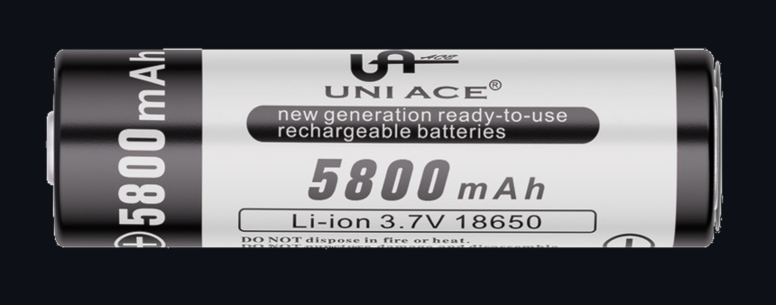
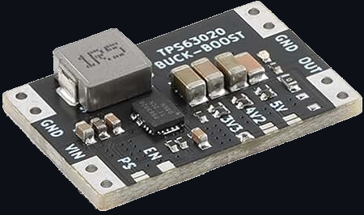
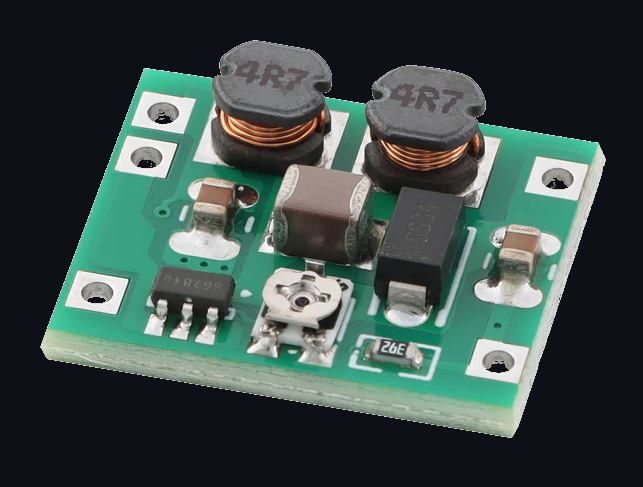
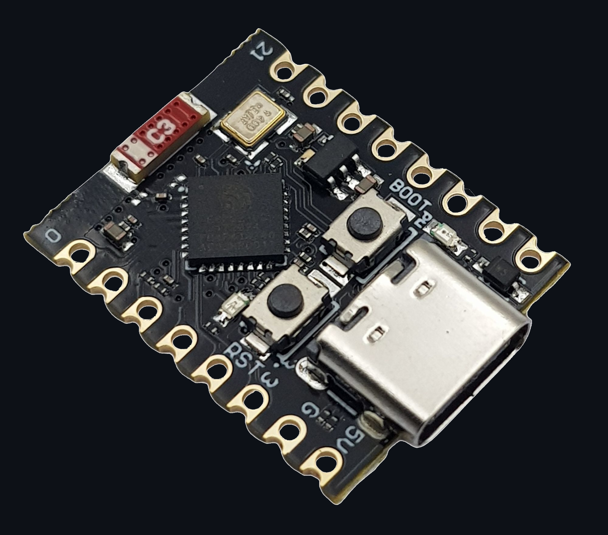
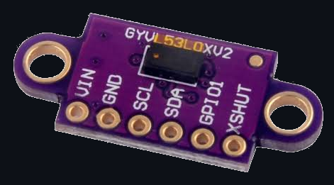
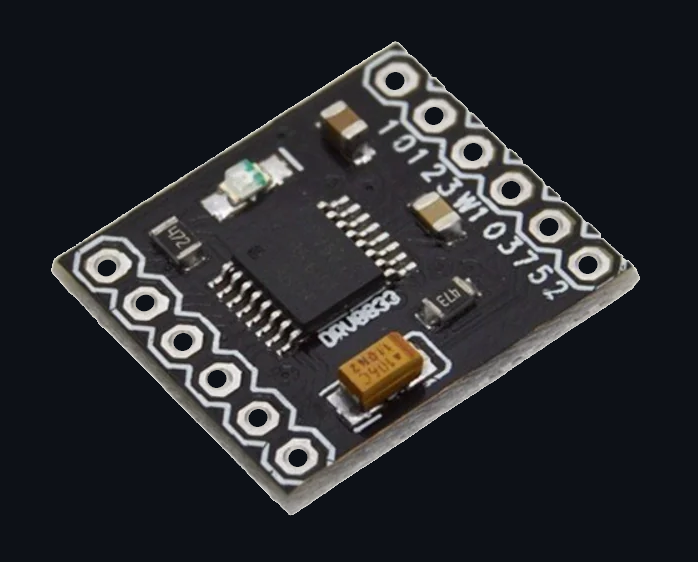
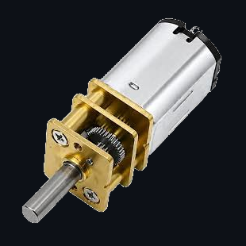
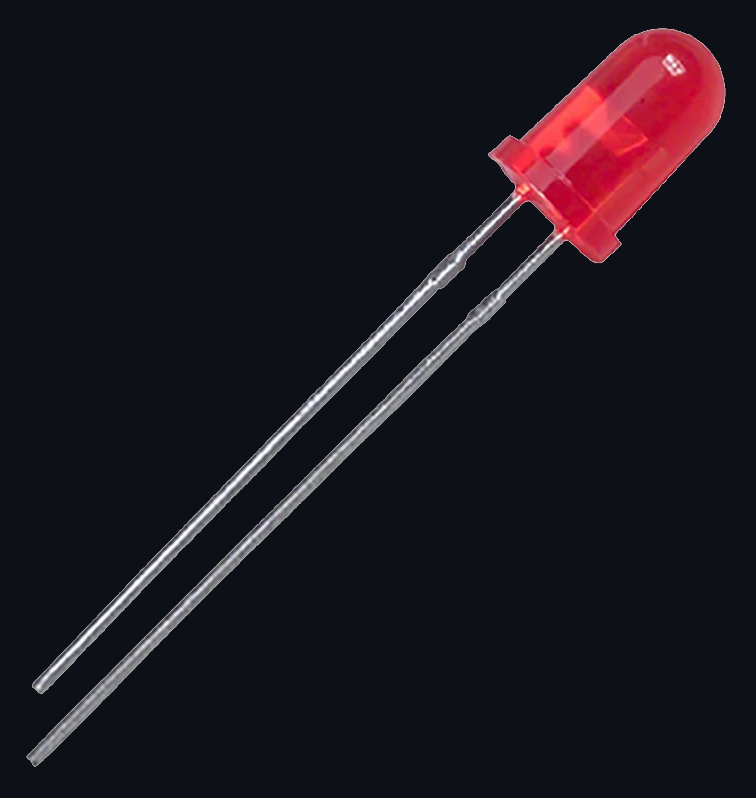

# Rail Bot Electronic Components
Below are the electronic components used for building the Rail Bot along with their brief specification in relation to the Rail Bot.

---

  
Component Summary

  <ol>
    <li><a href="#power-components">Power Components</a>
        <ol>
            <li><a href="#1--18650-lithium-ion-battery">18650 Lithium-Ion Battery Cell</a></li>
            <li><a href="#2--xl63020-buck-boost-converter-breakout-module">XL63020 Buck-Boost Converter Breakout Module</a></li>
            <li><a href="#3--b6284o-adjustable-buck-boost-converter-breakout-module">B6284o Adjustable Buck-Boost Converter Breakout Module</a></li>
        </ol>
    <li><a href="#logic-components">Logic Components</a>
        <ol>
            <li><a href="#4--esp32-c3-super-mini">ESP32-C3 Super Mini</a></li>
            <li><a href="#5--gy-vl53l0xv2-breakout-module---amount-2">GY-VL53L0XV2 Breakout Module</a></li>
        </ol>
    <li><a href="#state-components">State Components</a>
        <ol>
            <li><a href="#8-through-hole-led">Through-Hole LED</a></li>
        </ol>
  </ol>

---

 

## Power Components
### 1.  18650 Lithium-ion Battery 
- Used Brand Product: UNI ACE 2.0 Upgrade 18650 Rechargeable Li-ion Battery
- Rated Voltage-output: 3.7V
- Rated Current Capacity: 5800mAh
- Protected: Yes
- Rechargeable: Yes

### 2.  XL63020 Buck-Boost Converter Breakout Module 
- IC: Texas Instruments TPS63020
- Rated Voltage Input: 1.8V-5.5V (DC)
- Rated Voltage Output: 3.3V (Configurable to 3.3V, 4.2V, 5V) (Set to 3.3V for the Logic Components)
- Rated Current Output: 1.3A (Current output at 3.3V Voltage output)
- Operating Mode: Normal
- Size Dimensions: 17.4x26.2 mm (manual measurement)
- Pins: VIN, GND (VIN), OUT, GND (OUT)
- Pads: EN, 3V3 (Bridged), PS (Unbridged)

### 3.  B6284o Adjustable Buck-Boost Converter Breakout Module 
- IC: SHOUDING SB6284 (Used with SEPIC)
- Rated Voltage Input: 3V-15V (DC)
- Rated Voltage Output: 3V (Adjustable from 1V-15.5V) (Set to 3V for the Motor Components)
- Rated Current Output: 700mA (Max)
- Size Dimensions: 18x15 mm (manual measurement)
- Pins: IN+, IN-, EN, OUT+, OUT-

 

## Logic Components
### 4.  ESP32-C3 Super Mini 
- Matching specifications with online resources.

### 5.  GY-VL53L0XV2 Breakout Module  &emsp; <i>Amount: 2 </i>
- IC: VL53L0X
- Rated Voltage Input: 2.8V-5.5V
- Rated Voltage Logic Level: 3.3V (3.3V or 5V)
- Rated Current Draw: 30mA (max)
- Interface: I2C
- Default Device Address: `0x29`
- Measurement Speed: <30ms
- Field of View: 25°
- Operating Temperature: -20°C - 70°C
- Rated Range: 3-200 cm (Long-Range Mode) (50-120 cm Standard Mode)
- Size Dimensions: 10.5x13.3 mm (manual measurement)
- Pins: VIN, GND, SCL, SDA, GPIO1, XSHUT

 

## Motor Components
### 6. DRV8833 Dual H-Bridge Motor Driver Module (HW-627, Generic)
- IC: DRV8833
- Rated Voltage Input: 3V-10V
- Rated Current Output: 1.5A (Single H-Bridge Output)
- Channels: 2 (A: IN1, IN2, OUT1, OUT2; B: IN3, IN4, OUT3, OUT4)
- Overcurrent Protection: Yes
- Short Circuit Protection: Yes
- Undervoltage Lockout: Yes
- Overheating Protection: Yes
- Size Dimensions: 10.5x13.3 mm (manual measurement)
- Pins: IN1, IN2, IN3, IN4, OUT1, OUT2, OUT3, OUT4, EEP (nSLEEP), ULT (nFAULT)

### 7. GA12-N20 DC Motor
- Reduction Ratio: 1:200
- Rated RPM: 150 RPM
- Rated Voltage Input: 3V
- Rated No-Load Current Draw: 60mA
- Rated Load Current Draw: 90mA
- Rated Stall Current Draw: 300mA
- Rated Load Torque: 0.025-0.030 kg·cm
- Rated Stall Torque: 2.5 kg·cm
- Size Dimensions: 12x10x24 mm (manual measurement)
- Pins: Positive, Negative

 

## State Components
### 8. Through-Hole LED
- Color: Red
- Rated Forward Voltage: 1.8V-2.2V
- Rated Forward Current: 15mA-20mA
- Rated Max Forward Current: 20mA-30mA
- Size Dimensions: 8.6X2.54X5 mm

 

---

### END OF DOCUMENT